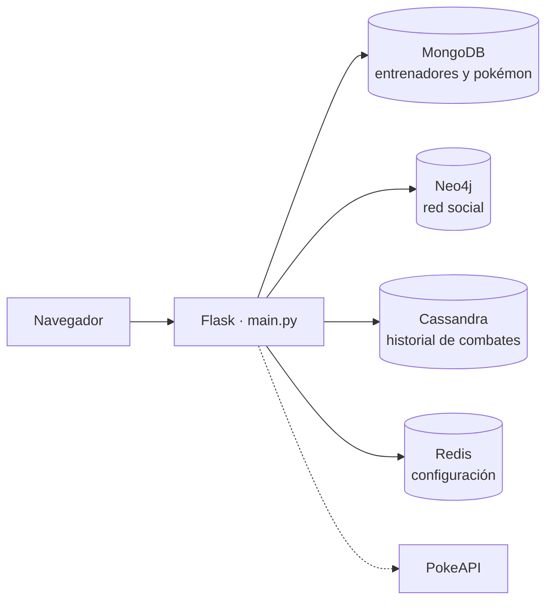

# Pokengue — Persistencia políglota con MongoDB, Neo4j, Cassandra y Redis

Aplicación web en Flask que gestiona una liga de entrenadores Pokémon usando **cuatro bases NoSQL**, cada una elegida según el tipo de dato y de consulta que mejor resuelve.

Trabajo Práctico Integrador de **Ingeniería de Datos II** (UADE, 2026), desarrollado en equipo por 7 integrantes. Esta es una copia del repositorio original del equipo, con el historial completo de commits.

## Arquitectura



| Base | Qué guarda | Por qué esa base |
|---|---|---|
| **MongoDB** | Entrenadores y pokémon como documentos, con datos de la [PokeAPI](https://pokeapi.co) | Esquema flexible y búsquedas por texto |
| **Neo4j** | Grafo `(Entrenador)-[:TIENE]->(Pokemon)` y `(Entrenador)-[:ES_AMIGO_DE]-(Entrenador)` | Recorridos de relaciones: recomendación de amigos (amigos de amigos) y rivales potenciales (comparten pokémon) |
| **Cassandra** | Historial de combates en 4 tablas diseñadas por consulta (por id, por fecha y por cada jugador) | Escrituras masivas y lecturas por clave de partición |
| **Redis** | Configuración de cada entrenador (idioma, tema, notificaciones, medallas) | Acceso en memoria e índices invertidos para filtrar al instante |

El código está organizado en capas: `db/` (conexiones singleton), `DAO/` (acceso a datos por base), `services/` (lógica de Neo4j), `modelos/` (clases del dominio) y `templates/` (una página por base).

## Mi participación

Desarrollé el **módulo de Redis** completo:

- `DAO/RedisDAO.py`: modelado clave-valor con un hash por entrenador (`entrenador:config:{id}`) e **índices invertidos** con sets por idioma, tema, notificaciones y medalla.
- Escrituras con **pipelines transaccionales**, que actualizan la configuración y los índices de forma atómica.
- Búsqueda combinada por varios criterios con **`SINTER`** (intersección de sets).
- `db/ConexionRedis.py`, las rutas `/redis/*` de la API y la página `templates/redis.html`.
- Carga inicial de datos (`redis_dump.rdb`).

## Cómo ejecutarlo

Requiere Python 3 y Docker.

```bash
git clone https://github.com/jeqm0302/pokengue-nosql.git
cd pokengue-nosql
python -m venv venv
venv\Scripts\activate
pip install -r requirements.txt
```

Levantar las bases:

```bash
docker run -d --name redis-pokengue -p 6379:6379 redis:latest
docker run -d --name cassandra-pokengue -p 9042:9042 cassandra:latest
docker run -d --name mongo-pokengue -p 27017:27017 mongo:latest
docker run -d --name neo4j-pokengue -p 7474:7474 -p 7687:7687 -e NEO4J_AUTH=neo4j/pokengue neo4j:latest
```

Crear el keyspace de Cassandra (esperar 1–2 minutos a que inicie):

```bash
docker exec -it cassandra-pokengue cqlsh -e "CREATE KEYSPACE IF NOT EXISTS pokengue WITH replication = {'class': 'SimpleStrategy', 'replication_factor': 1};"
```

Cargar los datos de Redis:

```bash
docker stop redis-pokengue
docker cp redis_dump.rdb redis-pokengue:/data/dump.rdb
docker start redis-pokengue
```

Iniciar la app y abrir http://127.0.0.1:5000:

```bash
python main.py
```

Las conexiones usan `localhost` por defecto y se pueden cambiar con variables de entorno (`MONGO_URI`, `NEO4J_URI`, `NEO4J_USER`, `NEO4J_PASSWORD`, `REDIS_HOST`, `REDIS_PORT`).

> La carga de entrenadores desde Google Sheets necesita credenciales propias de una cuenta de servicio de Google en `pokengueCredentials.json`. Ese archivo no está incluido en el repositorio.

## Datos

Carpeta `datos/`: 100 entrenadores, 50 pokémon, 400 relaciones de pertenencia, 150 amistades y 100 combates.

## Equipo

Díaz Ezequiel · González Pérez Bárbara · Núñez Gagliano Francisco · **Quijada Jesús** · Ragagnin Nicolás · Salas Agustín · Sandoval Marianella

## Tecnologías

Python · Flask · MongoDB (pymongo) · Neo4j (Cypher) · Cassandra (CQL) · Redis · Docker · PokeAPI · Google Sheets API